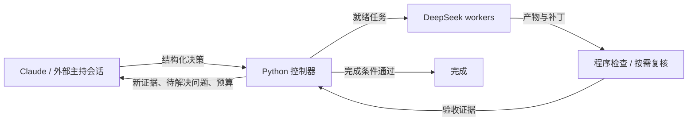

# deepseek-swarm

[English](README.md) · **简体中文**

**让 Claude 负责判断方向，让 DeepSeek 执行具体工作，用可验证的结果推进下一轮。**

deepseek-swarm 是面向 Claude Code 和 Codex 的技术型 skill，也可以直接通过 Python CLI 使用。
它把任务拆分、并行执行、程序检查、结果复核和下一步决策连接起来，适合需要多轮调查、实现、验收与调整的工作。
外部主持模式可以复用当前 Claude Code 或 Codex 会话；自动主持模式通过配置的 Claude backend 持续决策。

[快速开始](#快速开始) · [选择工作流](#选择工作流) · [研究模式](#研究模式让新证据影响下一步) · [成本与上下文](#成本与上下文) · [命令参考](#命令参考) · [英文详细参考](README.md#decision-protocol)



## 适合做什么

| 场景 | 工作方式 |
|---|---|
| 阅读大量材料、跨文件提取信息 | DeepSeek 分块阅读并输出短结果，主持者核对关键依据、汇总判断 |
| 陌生代码库分析、日志诊断 | 先收集证据，再根据结果决定下一轮调查范围 |
| 写测试、实现独立模块、修复代码 | 在独立 worktree 中执行，以测试、补丁和路径范围验收 |
| 多轮实验与研究探索 | 记录观察、解释和假设版本，对关键结果审查后继续、验证或改向 |
| 固定批量任务 | 一次性并行执行，使用依赖关系安排先后顺序 |

任务很小时，直接在当前会话完成通常更合适。这个项目主要解决的是：大量执行工作可以拆出去，但方向判断、结果衔接和最终验收仍需要持续管理。

## 选择工作流

| 入口 | 适用情况 | 主要命令 |
|---|---|---|
| 一次性任务 `scripts/swarm.py` | 开始时就能确定任务清单 | `check`、`plan`、`run` |
| 持续工作流 `scripts/swarm_loop.py` | 下一步取决于上一轮结果，需要修复、重规划或中断恢复 | `start`、`next`、`decide`、`auto` |
| 持续工作流 + 研究模式 | 需要保留假设、证据解释和方向调整记录 | `start --research`，决策使用 `review` |

两个入口共存，原有 `tasks.json` 可以继续使用。脚本仅依赖 Python 标准库，要求 Python 3.9+。

## 快速开始

### 1. 安装与环境检查

真实模型执行需要 Python、Claude Code CLI（`claude`）和 DeepSeek API key。DeepSeek worker 通过 Claude Code CLI 连接 DeepSeek 的 Anthropic 兼容接口。

```bash
git clone https://github.com/wucurtis91-del/deepseek-swarm ~/.claude/skills/deepseek-swarm
cd ~/.claude/skills/deepseek-swarm

export DEEPSEEK_API_KEY="YOUR_DEEPSEEK_API_KEY"
python3 scripts/swarm.py check
```

一次性入口也支持读取 CC Switch 中的 DeepSeek provider 配置。持续工作流使用角色配置指定凭证来源。
在 Codex 中使用时，将同一项目放在或链接到 Codex 的 skills 目录；规划与调度流程见 [SKILL.md](SKILL.md)。

下文命令均在项目根目录运行。

### 2. 先跑一个完整离线示例

```bash
# 持续工作流：启动 → 派发 → 执行与验收 → 完成
bash examples/loop/fake/run-demo.sh

# 研究模式：关键结果 → 解释与方向决策 → 完成
bash examples/research/fake/run-demo.sh
```

两个示例使用 fake backend，不需要 API key，也不会调用付费模型。运行结束会输出临时运行目录，里面可以查看状态、决策、产物和事件记录。

### 3. 配置实际任务

复制角色模板，按当前账号可用的模型和认证方式填写：

```bash
cp examples/loop/roles.example.json roles.json
```

主要角色如下：

| 角色 | 职责 | 典型配置 |
|---|---|---|
| `planner` | 拆任务、解释新证据、选择下一步、提出完成决策 | 自动模式配置 Claude；外部模式由当前会话主持 |
| `worker` | 执行具体任务，生成文件、短报告或代码补丁 | DeepSeek |
| `reviewer` | 按任务验收标准进行语义复核 | DeepSeek，按验收策略调用 |
| `critic` | 在重复失败或检查与复核分歧时审视假设 | 默认关闭，可单独配置 |

每个角色独立配置 provider、model、endpoint、凭证来源、工具、超时和输出上限。
完整字段见[角色模板](examples/loop/roles.example.json)和[英文角色参考](README.md#roles-and-provider-isolation)。

目标文件描述要解决的问题与完成标准。例如 `goal.json`：

```json
{
  "goal": "分析指定日志中的请求失败，找出主要原因并验证修复方案。",
  "constraints": ["只使用给定日志和项目文件", "保留可定位的证据引用"],
  "completion_criteria": [
    {"id": "g1", "text": "主要失败原因有日志或可复现实验支持"},
    {"id": "g2", "text": "修复方案通过针对该问题的检查"}
  ]
}
```

代码任务还需要通过 `workspace.repo` 或 `start --workspace /absolute/path/to/repo` 指定 Git 仓库。

## 持续工作流

### 外部主持：复用当前 Claude Code 或 Codex 会话

这是默认模式。当前会话阅读 packet、写出 JSON 决策，控制器执行就绪任务并生成下一份材料。

```bash
python3 scripts/swarm_loop.py start runs/demo --goal goal.json --config roles.json
python3 scripts/swarm_loop.py next runs/demo

# 当前主持会话根据 packet 写出 decision.json
python3 scripts/swarm_loop.py decide runs/demo decision.json
python3 scripts/swarm_loop.py next runs/demo
python3 scripts/swarm_loop.py status runs/demo
```

重复 `next → 决策 → decide`，直到目标完成，或运行进入暂停、等待输入、取消状态。
启动配置随运行保存，后续命令默认沿用。控制器记录自身发起的调用；外部主持会话用量记为 `external_unmetered`，成本覆盖为 `partial`。

### 自动主持：由配置的 planner 推进

```bash
python3 scripts/swarm_loop.py start runs/auto \
  --goal goal.json --config roles.json --mode auto
python3 scripts/swarm_loop.py auto runs/auto --max-steps 20
```

自动模式与外部模式使用同一决策协议、验收和预算逻辑。自动模式会调用配置的 planner；planner 不可用时，运行保存暂停原因。

### 如何选择下一步

| action | 含义 |
|---|---|
| `dispatch` | 新增任务，依赖满足后执行 |
| `repair` | 保留方法，修复实现或验收失败；代码任务继承上一版补丁 |
| `verify` | 对已有结果追加独立验证任务 |
| `replan` | 调整任务定义和依赖，取消旧任务，切换实施方案 |
| `review` | 研究模式下解释观察、记录方向，不创建执行任务 |
| `request_context` | 按引用读取产物或研究分页，补充下一轮决策材料 |
| `request_input` | 提出具体问题，等待用户补充信息 |
| `pause` | 保存状态并暂停 |
| `complete` | 提交逐项完成证据，由控制器验证后结束 |

每个任务说明 `question`（解决什么未知）、`produces`（产生什么结果）、`decision_impact`（如何影响后续），并给出带 ID 的验收标准。
可直接参考[任务与决策示例](examples/loop/README.md)和[完整决策协议](README.md#decision-protocol)。

## 研究模式：让新证据影响下一步

研究过程中，实验没跑通、测量不可靠、假设受到反证，是不同的问题。研究模式把它们放在独立记录中，让主持者能基于当前证据决定下一步。

```bash
python3 scripts/swarm_loop.py start runs/research \
  --goal examples/research/goal.json --config roles.json --research
python3 scripts/swarm_loop.py next runs/research
```

也可以在目标中设置 `"research": true`，或在配置中设置 `loop.research_mode: true`。

### 四类持久记录

| 记录 | 内容 |
|---|---|
| 观察 `observations` | 任务实际产生了什么结果，关联产物、哈希、来源与版本 |
| 解释 `interpretations` | 观察在什么条件下支持、反对某个假设，或仍不足以下结论 |
| 假设 `hypotheses` | 假设内容、适用范围、当前版本和证据状态 |
| 审查 `reviews` | 为什么继续、补实验、缩小范围、切换、暂停或停止 |

例如，某轮实验没有得到预期结果：主持者可以先将解释记为 `inconclusive`，派发校准或复现实验；得到有效反证后，再显式修订假设与依赖任务。

### 关键结果怎样进入决策

- `tests_hypotheses` 表示任务检验哪些假设；`depends_on_hypotheses` 表示结果的可用性依赖哪些假设。
- `key_experiment: true` 会让完成结果进入待审列表，即使尚未被解释为反证。
- `research_prediction` 可声明程序检查的预期退出码；检查不匹配时产生待审事件。
- 主持者用 `review` 引用观察、假设版本、解释与方向，也可以在派发新任务的同一条决策中提交研究判断。
- 定义、范围或显式状态变化会触发依赖复审；旧解释通过 `supersedes` 修订，历史保留。

**投入方向与假设有效性分开记录。** 因成本转向另一条路线，可以使用 `direction.switch`；这本身不改变假设状态。假设内容、适用范围或有效性变化，通过 `hypothesis_updates` 明确表达。

完成前，控制器在同一事务中应用研究更新、传播依赖变化、刷新证据，再验证完成条件。仍有待审事件或证据失效时，返回具体原因，保留可继续处理的状态。

研究模式复用现有 planner 调用和预算。完整 JSON 模板见[研究模式示例](examples/research/README.md)。

## 验收、代码与恢复

### 按任务选择验收方式

| `acceptance_policy` | 通过条件 |
|---|---|
| `deterministic` | 每条标准关联的程序检查通过 |
| `semantic` | 复核员逐项通过全部验收标准 |
| `combined` | 程序检查与语义复核都通过 |
| `none` | 保存为未验收草稿，不作为完成证据 |

确定性检查先执行，失败时可直接进入修复。写测试的任务还可配置 `negative_check`，向副本注入已知错误，验证测试是否能检出。

`complete` 必须引用当前有效的产物证据。控制器沿完整依赖链检查任务状态、版本、产物与补丁哈希、输入文件及验收结果；变更会使旧证据失效。

### 代码任务

代码任务在独立 Git worktree 中执行，记录基线 commit、改动文件、patch、测试结果和允许路径。
上游补丁先应用到输入基线；`repair` 继承上一版任务补丁，保留已有工作和历史版本。
补丁冲突、越界改动与不确定的中断结果会作为明确状态返回主持者。

worktree 隔离代码改动，`allowed_paths` 用于验收范围。worker 和检查进程以当前用户权限执行；运行权限与可读目录由本机环境管理。

### 保存与继续

运行目录包含 `state.json`、带哈希链的 `events.jsonl`、`packets/`、`decisions/`、`artifacts/` 和代码 worktree。
状态使用原子写入和单写者锁，快照可从事件日志恢复。

```bash
python3 scripts/swarm_loop.py status runs/demo
python3 scripts/swarm_loop.py artifacts runs/demo
python3 scripts/swarm_loop.py resume runs/demo
python3 scripts/swarm_loop.py cancel runs/demo --reason "暂停本次工作"
```

已经完成且仍有效的任务会保留；中断任务记录为 `interrupted` 或 `unknown`，由主持者决定修复或重规划。输入、上游结果或角色配置变化会触发 `stale`。

## 成本与上下文

节省成本主要来自减少重复阅读、无效执行和不必要的复核：

- **按批次决策**：主持者在结果汇总后判断下一步，worker 处理具体工作。
- **按需读取**：packet 提供摘要、证据引用与短片段，全文保存在产物文件中，需要时分页读取。
- **限制输出**：任务用 `max_chars` 控制交回正文长度，角色配置输出 token 上限。
- **先做程序检查**：检查失败时跳过语义复核，带着具体错误修复。
- **按需启用额外角色**：critic 与模型压缩默认关闭，启用后的调用分别计量。
- **保留有效工作**：代码 repair 继承补丁，恢复运行保留已完成任务。

预算支持调用次数、工作流轮数、运行时长、估算 token、美元、每任务修复次数及各角色调用数。
并发调用先预留预算；`max_seconds` 控制是否启动新调用，在途调用由自身超时或取消结束。
Token 与美元预算按可获得用量估算；未知费用单独记录，外部主持用量单独标注。

多轮规划与复核也有开销。是否更省钱，应比较整个任务的 planner、worker、reviewer、重试与验收成本。
现有[一次性任务实测](benchmarks/2026-10-22-nodal-mesh.md)和[基准工具说明](README.md#benchmark-harness)可作为参考。

## 命令参考

| 命令 | 用途 |
|---|---|
| `swarm.py check` | 检查真实执行环境 |
| `swarm.py plan tasks.json` | 展开 inputs、依赖和检查命令，不调用模型 |
| `swarm.py run tasks.json` | 执行固定任务清单 |
| `swarm_loop.py start RUN --goal FILE --config FILE` | 创建持久运行，保存目标与配置 |
| `swarm_loop.py next RUN` | 读取当前决策材料 |
| `swarm_loop.py decide RUN decision.json` | 应用决策并执行就绪任务 |
| `swarm_loop.py auto RUN --max-steps N` | 由配置的 planner 自动推进 |
| `swarm_loop.py status RUN` | 查看状态与预算 |
| `swarm_loop.py resume RUN` | 恢复运行 |
| `swarm_loop.py artifacts RUN` | 查看产物 |
| `swarm_loop.py validate RUN decision.json` | 校验决策文件 |
| `swarm_loop.py cancel RUN` | 请求取消运行 |

各命令完整参数见 `python3 scripts/swarm_loop.py --help` 及对应子命令的 `--help`。

## 测试与评测

```bash
# 离线回归测试
python3 -I -m unittest discover -s tests -v

# 固定案例的离线控制流与计量验证
python3 benchmarks/harness.py --mode fake --include-claude-alone --out /tmp/swarm-benchmark
```

Fake 模式验证调度、验收、恢复和指标采集；真实模型的方向判断能力与成本差异由真实对照实验衡量。
[研究评测 fixtures](benchmarks/research/README.md)包含固定证据回放和可选择实验的环境，区分模型可见输入与评测答案，并定义了方向调整、无效投入和调用成本等指标。

## 文档导航

- [English README 与完整配置、协议参考](README.md)
- [SKILL：规划者操作指南](SKILL.md)
- [持续工作流示例](examples/loop/README.md)
- [研究模式与 JSON 决策示例](examples/research/README.md)
- [研究评测协议](benchmarks/research/README.md)
- [已有 benchmark 记录](benchmarks/)

## 许可证

[MIT](LICENSE)

[English](README.md) · **简体中文**
